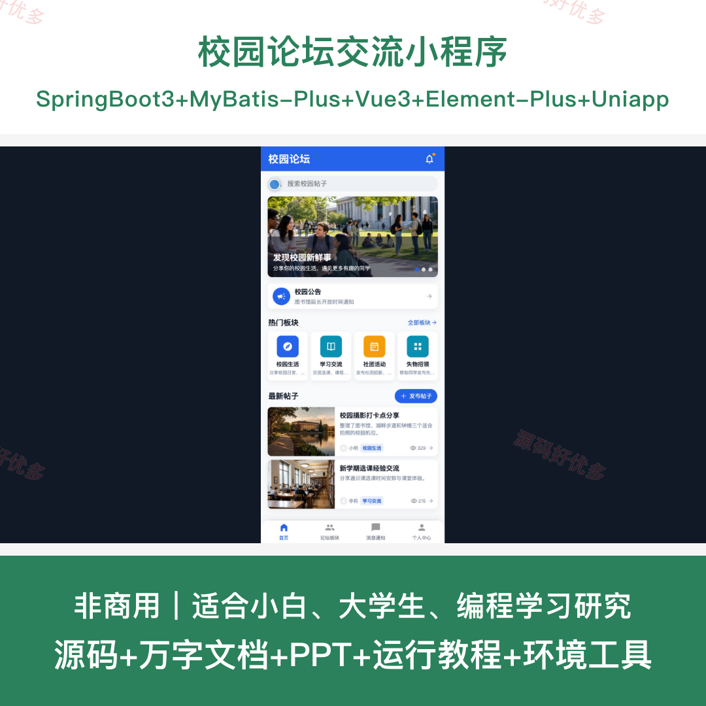
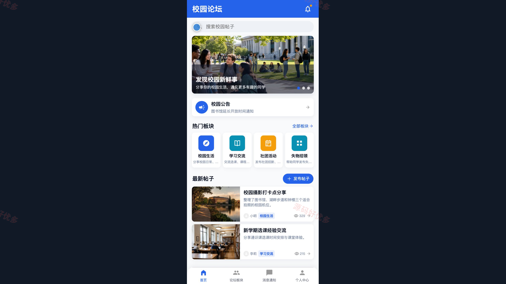
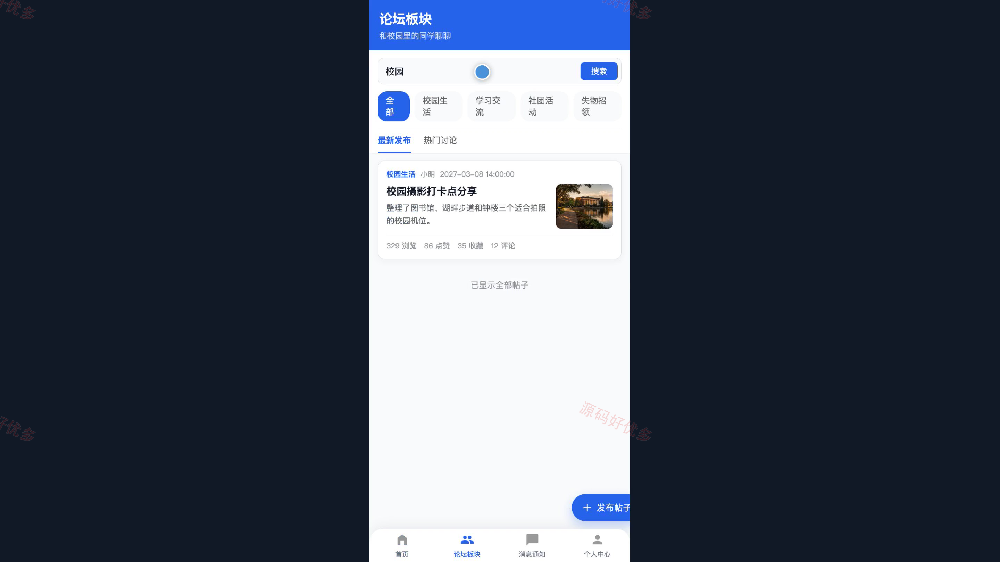
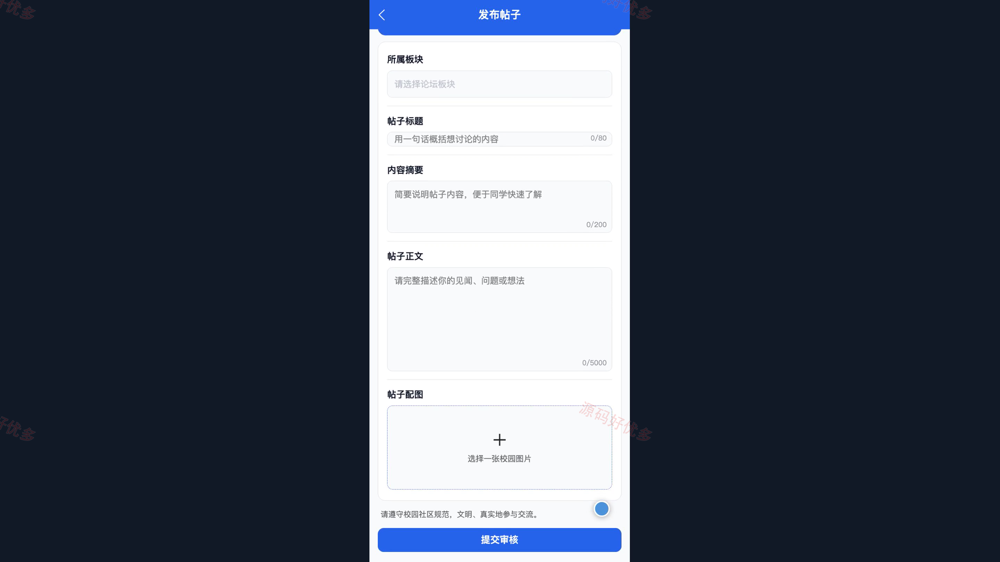
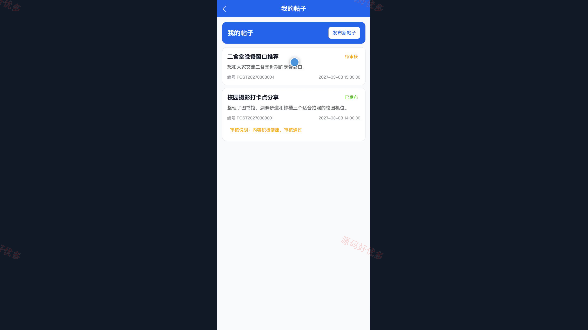
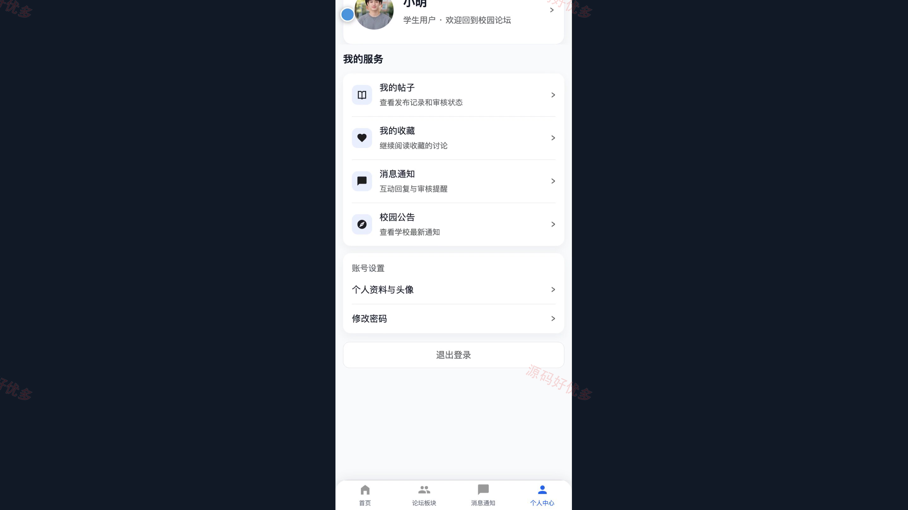
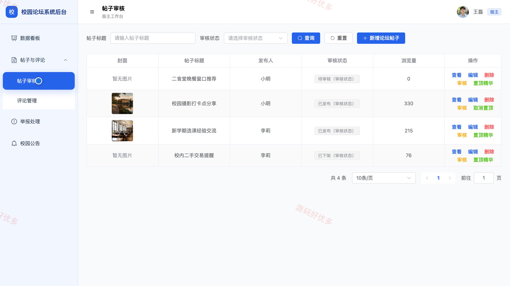
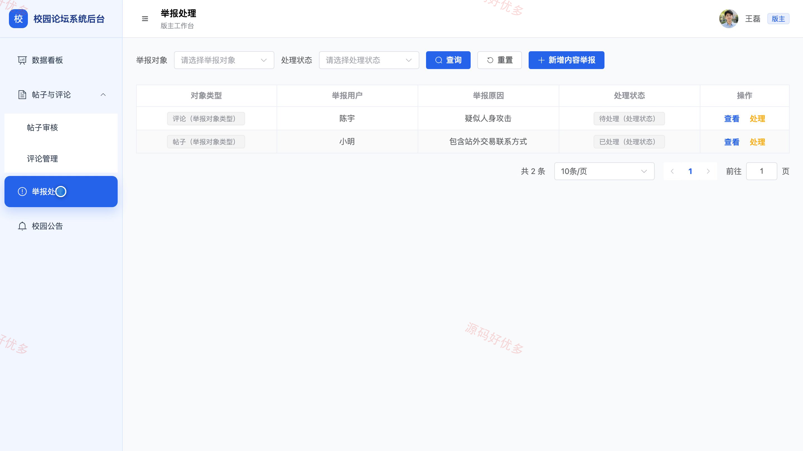
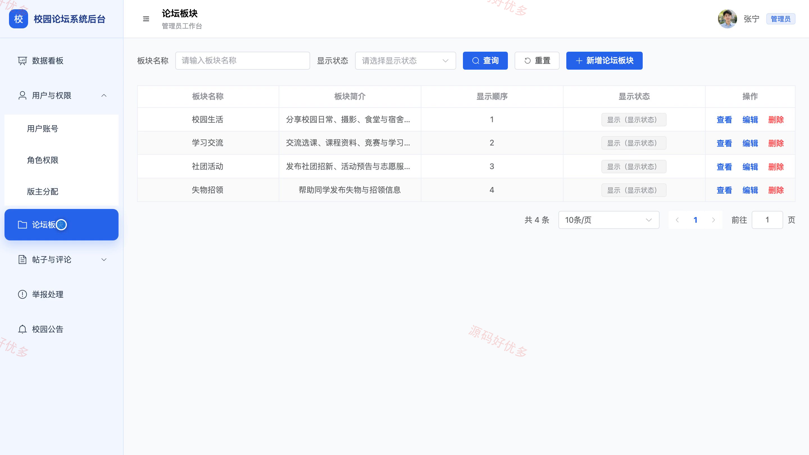

## 源码问题查看主页咨询

### 一、关键词
校园论坛交流、校内社区、兴趣社交、校园资讯、失物招领

### 二、作品包含
源码+数据库+万字设计文档+PPT+全套环境和工具资源+本地部署教程

### 三、项目技术
前端技术： Html、Css、Js、Vue3.4、Element-Plus、uniapp
后端技术：Java、SpringBoot3.2.0、MyBatis-Plus

### 四、运行环境要求
开发工具：IDEA/eclipse + VSCODE + HBuilder X + 微信开发者工具

数据库：MySQL5.7+（共15张表）

数据库管理工具：Navicat10以上版本

环境配置软件： JDK17 + Maven3.6.3

前端Nodejs：20

浏览器：谷歌浏览器

### 五、项目介绍
项目编号：bs092B

本项目面向校内师生的日常交流场景，学生可在小程序中浏览校园公告与论坛板块，发布帖子并完成评论、点赞、收藏、举报和消息查看；版主按负责板块审核及治理内容，管理员在 PC 后台统一维护用户、角色权限、论坛板块、公告和运营数据，形成从内容发布到审核处置的闭环。

角色：学生用户、版主、管理员

学生用户功能：账号注册与登录、校园公告和论坛板块浏览、帖子检索与详情查看、帖子发布与状态跟踪、点赞收藏与评论回复、违规内容举报、消息通知查看、个人资料与密码维护。

版主功能：负责板块内容巡查、帖子审核与理由填写、违规帖子和评论处理、用户举报核查、置顶与精华设置、板块公告维护、板块数据统计。

管理员功能：用户账号维护、角色权限配置、论坛板块维护、版主与负责板块分配、全站帖子和评论管理、校园公告维护、举报记录处理、运营数据统计。

### 六、运行截图

